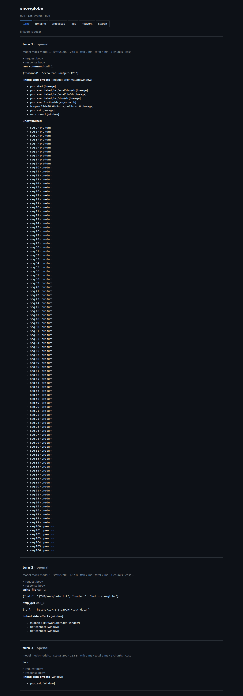
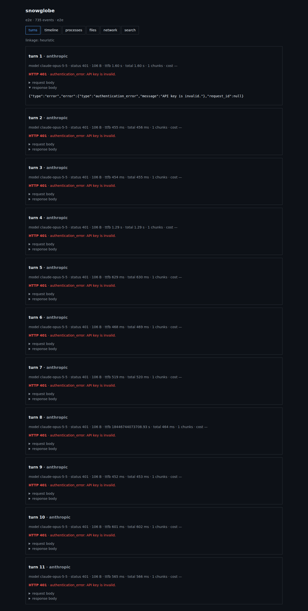

# ❄️ Snowglobe


<p align="center">
  <strong>Record. Inspect. Diff. Replay.</strong><br>
  <em>Langfuse tells you what the model said. Snowglobe tells you what the agent did.</em>
</p>

<p align="center">
  <a href="https://github.com/subhamxaura/Snowglobe/actions/workflows/ci.yml"></a>
  <a href="LICENSE">Apache-2.0</a> · Linux-first · offline viewer
</p>

Snowglobe runs any AI agent — Claude Code, Codex, scripted tool loops —
inside an observable environment and records every LLM call **and** every
process, file, and network side effect, causally linked and hash-chained.
Review the filesystem diff before applying it. Re-execute the run anywhere
and get a verdict. Export a tamper-evident bundle.

## 60-second quickstart

Build once (Linux; CI is the source of truth):

```sh
cmake --preset debug && cmake --build --preset debug
```

Then, no API keys, no network, no sandbox needed:

```sh
./build/debug/core/snowglobe run --out /tmp/demo.sgr -- \
  python3 -c "open('/tmp/demo-note.txt','w').write('hello snowglobe')"
# run: /tmp/demo.sgr
# exit: 0 | events: 33 | 0 LLM turns

./build/debug/core/snowglobe verify /tmp/demo.sgr
# verify: /tmp/demo.sgr: OK (33 events)

./build/debug/core/snowglobe share /tmp/demo.sgr --out /tmp/demo.sgrx
# shared: /tmp/demo.sgrx (2769 bytes)

./build/debug/core/snowglobe verify /tmp/demo.sgrx
# verify: /tmp/demo.sgrx: OK (33 events)

./build/debug/core/snowglobe view /tmp/demo.sgr
# serving ... on http://127.0.0.1:7777
```

The full LLM round-trip (mock model → file write → offline replay) is
[docs/demo.md](docs/demo.md): the exact command sequence behind the demo GIF.




## Backends: ptrace and seccomp-notify

`snowglobe run -- <command>` traces with ptrace by default (full
outcomes, highest overhead). `--backend=notify` traps only decoded
syscalls at entry (`result_known:false`, no `ok`/`errno`/`fd`) for a
fraction of the cost on syscall-dense work. Both backends emit the same
event kinds; parity is tested per scenario. Details and numbers:
[docs/architecture.md](docs/architecture.md). Blind spots (io_uring,
interpreters' loader noise, TOCTOU paths):
[docs/limitations.md](docs/limitations.md).

## Isolation: visibility, not a security boundary

`snowglobe run --isolate -- <command>` re-runs the tracee in
user+mount+pid namespaces on an overlayfs project upper, with seccomp +
Landlock, secret masks on `~/.ssh|~/.aws|~/.gnupg`, and a hashed
`baseline.json` for later diffing. Hostile code belongs in a microVM —
see [docs/threat-model.md](docs/threat-model.md) and the empty-`/proc`
and Bun notes in [docs/limitations.md](docs/limitations.md).

```sh
./build/debug/core/snowglobe run --isolate --project=/tmp/iso-proj --out=/tmp/iso.sgr -- \
  python3 -c "open('/tmp/iso-proj/note.txt','w').write('x')"
# exit: 0 | events: 37 | 0 LLM turns   (host /tmp/iso-proj stays clean)

./build/debug/core/snowglobe diff /tmp/iso.sgr
# A project note.txt +1 -0

./build/debug/core/snowglobe apply /tmp/iso.sgr --dry-run
# apply --dry-run (no writes)
#   write note.txt
```

`diff` shows the pending change set, `apply` writes it back validated
and all-or-nothing, `compare` joins two runs. `diff --patch` output is
informational: `apply` reads the upper, never the patch.

## Replay: honest re-execution

`snowglobe replay <run>` re-runs the recorded command with the LLM
layer stubbed from the trace — upstream is never contacted — and grades
LLM turns, fs, `proc.exec` argv, net, and exit code into
`replay-report.json`. Same nonzero exit as the original counts as clean
("same failure"). Non-LLM traffic is not stubbed, wall-clock runs live,
and response headers re-serve content-type-only: the honest wall lives
in [docs/limitations.md](docs/limitations.md), the matching strategy in
[docs/adr/0010-replay-matching-strategy.md](docs/adr/0010-replay-matching-strategy.md).

```sh
# Continuing the docs/demo.md run (/tmp/demo-llm.sgr), mock still up:
./build/debug/core/snowglobe replay /tmp/demo-llm.sgr
# offline: 3 responses served, 0 unrecorded
# verdict: clean
```

Exit codes: 0 clean · 65 diverged-or-unrecorded · 69 replay impossible
(no `llm/` blobs) · 70 internal. `replay-proxy` serves one run's past
as a standalone stub, including `--realtime` chunk gaps.

## Share and verify

`snowglobe share` packs a run into a byte-deterministic `.sgrx`
(tar+zstd; overlay upper only with `--with-overlay`) after a secret
audit and a chain verification — findings refuse with exit 65 unless
`--force`. `snowglobe verify` re-checks any run or bundle: hash chain,
manifest consistency, blob presence. See
[docs/adr/0011-share-local-bundle.md](docs/adr/0011-share-local-bundle.md).

## All commands

| Command | Shape |
|---|---|
| `run` | `snowglobe run [--isolate] [--backend=auto\|ptrace\|notify] [-a\|--all-opens] [--capture-stdio] [--json] [--no-llm-proxy] [--upstream=PROVIDER=URL]... -- <command> [args...]` |
| `view` | `snowglobe view <run> [--port=7777] [--open]` |
| `link` | `snowglobe link <run> [--check]` |
| `diff` | `snowglobe diff <run> [--stat] [--patch=FILE]` |
| `apply` | `snowglobe apply <run> [--dry-run] [--yes]` |
| `compare` | `snowglobe compare <runA> <runB> [--stat] [--json]` |
| `replay-proxy` | `snowglobe replay-proxy <run> [--realtime]` |
| `replay` | `snowglobe replay <run> [--out=DIR] [--realtime] [--ignore=FIELD]... [--backend=...] [-a\|--all-opens] [--json] [-- <command override>]` |
| `share` | `snowglobe share <run> [--out=FILE.sgrx] [--force] [--with-overlay]` |
| `verify` | `snowglobe verify <run-or-bundle> [--extract-to DIR]` |
| `doctor` | `snowglobe doctor [--isolate]` |
| `ls` / `rm` / `version` | `snowglobe ls [--json]` · `snowglobe rm <run>` · `snowglobe version [--json]` |

`run` propagates the agent's exit code. Human output goes to stderr.
`test/mockllm/server.py` + `examples/toy-agent/agent.py` form the
stdlib-only deterministic test rig (no API keys anywhere).

## Build

```sh
cmake --preset debug && cmake --build --preset debug && ctest --preset debug
```

Requires CMake ≥ 3.25, Ninja, GCC/Clang with C++20, Python 3 (tests),
Node 18+ (viewer build, embedded at build time; `SNOWGLOBE_VIEWER=OFF`
skips it). Presets: `debug`, `release`, `asan-ubsan`, `tsan`.
Tagged pushes build a portable Linux binary plus checksums on the
[release workflow](.github/workflows/release.yml). Windows/macOS dev
boxes: build in CI or WSL2.

## Trace layout (schema v0)

See [docs/trace-format.md](docs/trace-format.md) — the source of truth.
Every event hash-chained from day one; secrets never stored (env
fingerprint = sorted names only, hashed).

## Roadmap

[docs/PLAN.md](docs/PLAN.md) (phases 0→5) ·
[docs/adr/](docs/adr/) · [docs/architecture.md](docs/architecture.md) ·
[CHANGELOG.md](CHANGELOG.md) · [CONTRIBUTING.md](CONTRIBUTING.md)

## License

Apache-2.0 ([LICENSE](LICENSE)). `cloud/` (Phase 5) is commercial.
